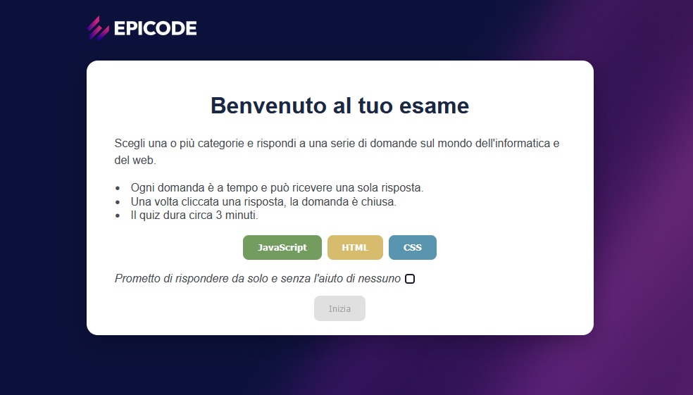
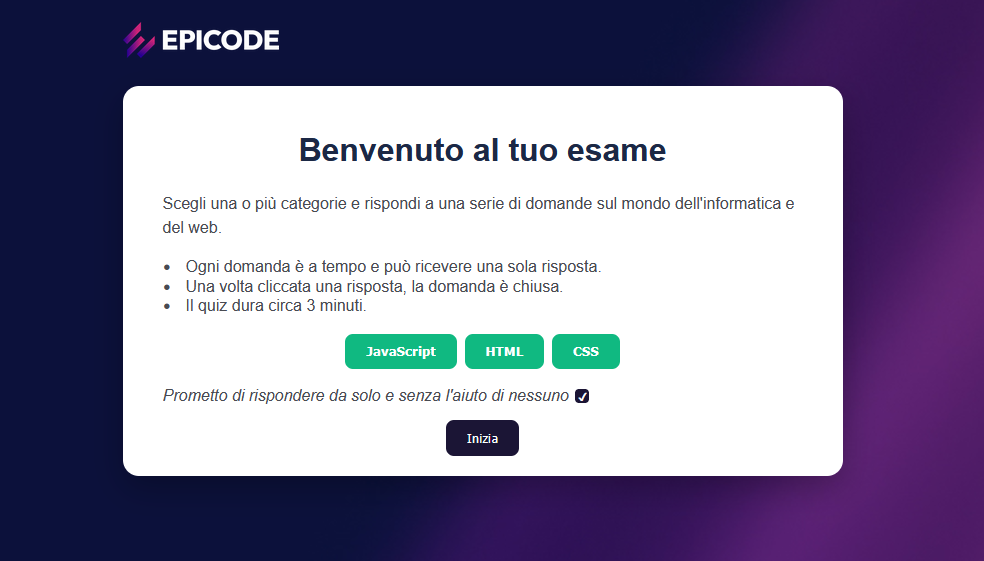
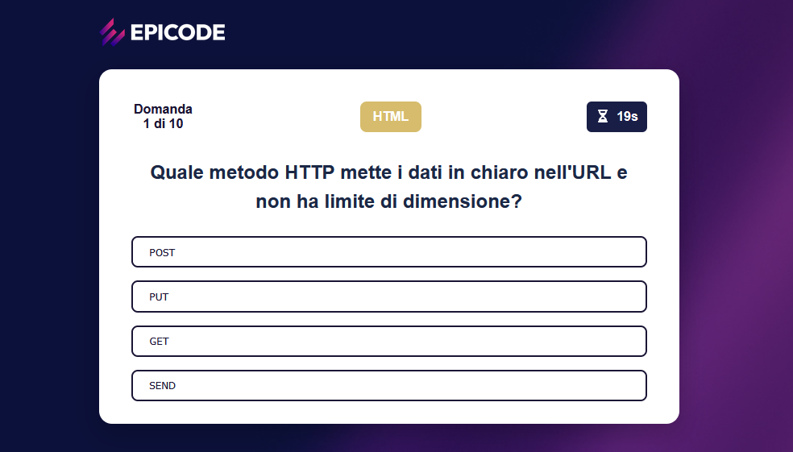
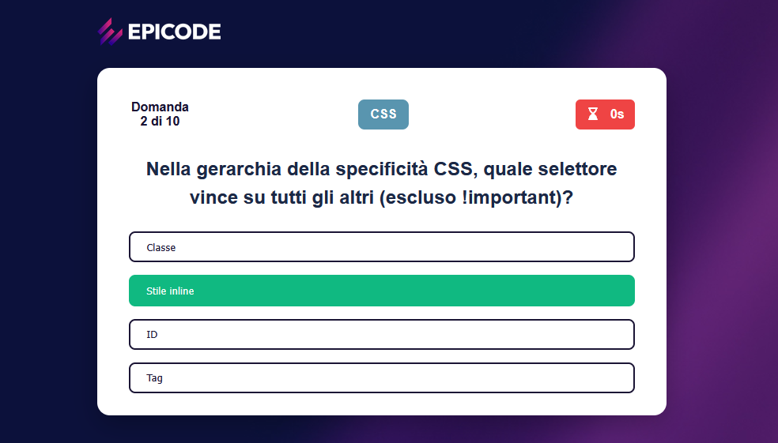
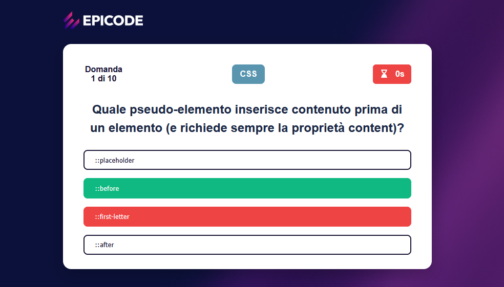
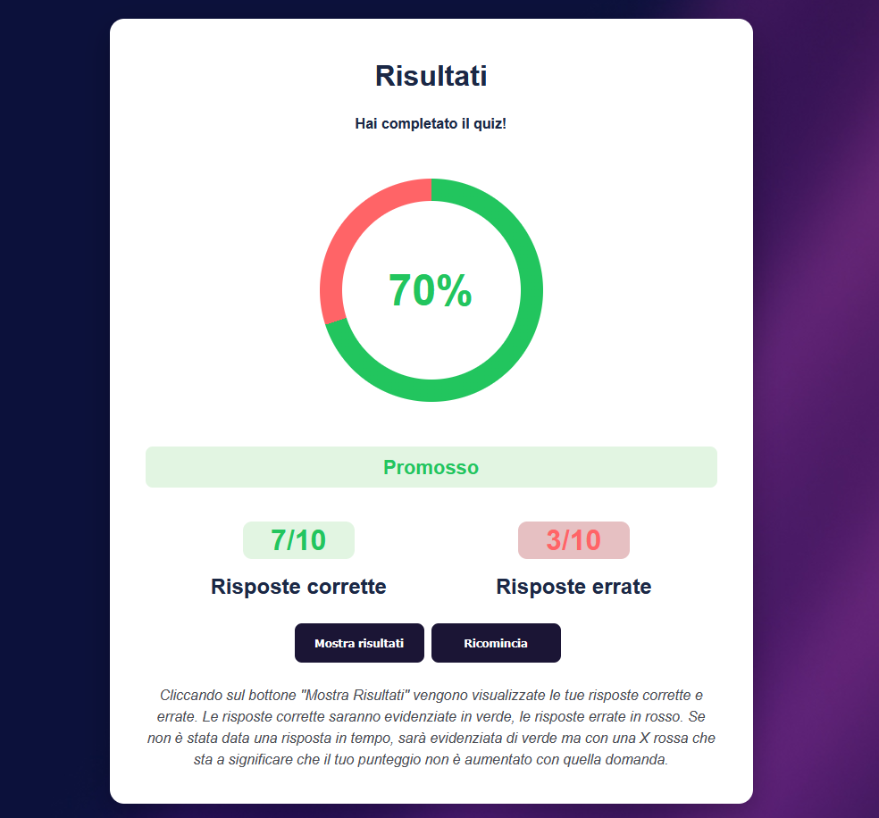
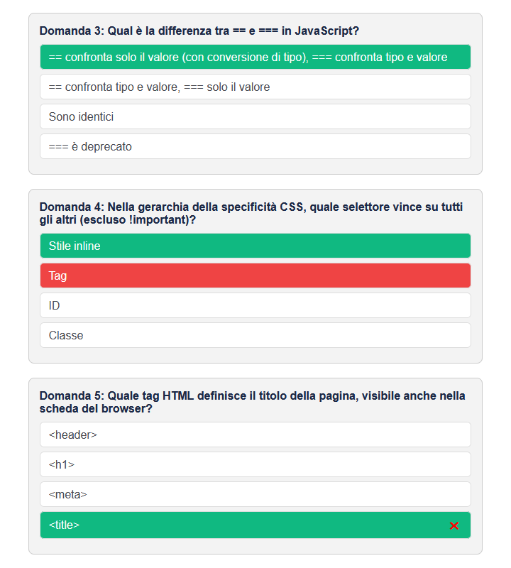

# Progetto Build Week 1 Team 3 - Quiz App

Quiz interattivo sul mondo del web: l'utente sceglie una o più categorie (**HTML**, **CSS**, **JavaScript**) e risponde a 10 domande a risposta multipla, ognuna con un tempo limite. Alla fine ottiene il punteggio, l'esito (Promosso / Bocciato) e un riepilogo di tutte le risposte.

Progetto realizzato in HTML, CSS e JavaScript puro, senza librerie né framework.

## 📸 Screenshot

<p align="center">
  <em>Schermate iniziali con bottoni delle categorie e checkbox, sia premuti che non premuti.</em>
</p>
<p align="center">
  
  &nbsp;&nbsp;
  
</p>

<p align="center">
  <em>Una domanda tipo si presenta in questo modo: con il numero della domanda sul totale delle domande del quiz, una dicitura che indica il linguaggio di programmazione della domanda e un timer che scorre insieme a una clessidra che gira.</em>
</p>
<p align="center">
  
</p>

<p align="center">
  <em>Se la risposta selezionata è corretta si evidenzia in verde; se è errata, si evidenzia in rosso quella sbagliata e in verde quella giusta.</em>
</p>
<p align="center">
  
  &nbsp;&nbsp;
  
</p>

<p align="center">
  <em>Schermata di fine quiz con grafico e percentuale delle domande corrette ed errate.</em>
</p>
<p align="center">
  
</p>

<p align="center">
  <em>Nella schermata "Mostra Risultati" della parte finale, le domande con risposta giusta sono evidenziate in verde ma con una X rossa accanto se la domanda non è stata data in tempo; sono evidenziate in verde se corrette, mentre in caso di risposta errata si evidenzia in rosso quella sbagliata e in verde quella giusta.</em>
</p>
<p align="center">
  
</p>


## ✨ Funzionalità

- **Categorie selezionabili**: HTML, CSS e JavaScript, scegliendone una o più (anche tutte insieme).
- **10 domande casuali**: ogni quiz estrae a caso 10 domande dalle categorie scelte. Sia le domande sia l'ordine delle risposte sono mescolati a ogni partita.
- **Categoria in evidenza**: durante il quiz, accanto al numero della domanda, viene mostrata la categoria a cui appartiene.
- **Timer per domanda**: 20 secondi per rispondere, con clessidra animata e colore rosso negli ultimi 5 secondi. Allo scadere del tempo la domanda viene considerata senza risposta.
- **Una sola risposta per domanda**: dopo il click la domanda si chiude e viene mostrato subito se la risposta è corretta (verde) o errata (rossa, con la risposta giusta evidenziata).
- **Conferma di correttezza**: per iniziare bisogna spuntare la checkbox in cui ci si impegna a rispondere da soli.
- **Risultati finali**: percentuale animata in un grafico circolare, numero di risposte corrette ed errate, esito **Promosso** con almeno il 60% di risposte corrette, altrimenti **Bocciato**.
- **Riepilogo delle risposte**: il bottone "Mostra risultati" mostra tutte le domande con la risposta corretta in verde e l'eventuale risposta sbagliata dell'utente in rosso. Se il tempo è scaduto, la risposta giusta è in verde con una ✖ rossa, a indicare che quella domanda non ha dato punti. Una legenda nella schermata dei risultati spiega i colori.
- **Ricomincia**: azzera il quiz e riporta alla schermata iniziale.

## 🛠️ Tecnologie usate

- **HTML5**: struttura della pagina.
- **CSS3**: layout con Flexbox, stati hover, `conic-gradient` per il grafico dei risultati.
- **JavaScript (ES6+)**: tutta la logica del quiz, con `const`/`let`, arrow function, `addEventListener`, `querySelector` e creazione degli elementi tramite DOM. Il codice segue il pattern **stato → render → eventi**.
- **Font Awesome**: icona della clessidra del timer (caricata tramite kit CDN).

## 📁 Struttura delle cartelle

```
quiz-app/
├── index.html
├── README.md
└── assets/
    ├── css/
    ├── js/
    └── img/
        ├── bg.jpg
        ├── epicode-logo.png
        └── screenshots/
            ├── benvenuto.png
            ├── benvenuto2.png
            ├── quiz.png
            ├── quizErrato.png
            ├── quizGiusto.png
            ├── risultato.png           
            └── risultatoDomande.png
```

## 🚀 Come avviarlo

1. Scarica o clona il progetto mantenendo la struttura delle cartelle qui sopra.
2. Apri `index.html` con un browser moderno (Chrome, Firefox, Edge, Safari). In alternativa, se usi VS Code, avvia l'estensione **Live Server** con "Open with Live Server".
3. Serve una connessione a internet solo per caricare l'icona della clessidra di Font Awesome. Senza connessione il quiz funziona ma l'icona non viene mostrata.

Non è richiesta nessuna installazione né build.

## 🎲 Come funziona la distribuzione delle domande

Ogni categoria contiene 10 domande. Il quiz ne estrae sempre **10 in totale**, divise in modo equo tra le categorie scelte:

| Categorie selezionate | Domande per categoria | Totale |
|---|---|---|
| 1 (es. HTML) | 10 | 10 |
| 2 (es. HTML + CSS) | 5 + 5 | 10 |
| 3 (HTML + CSS + JavaScript) | 3 + 3 + 4 | 10 |

Il calcolo è fatto dalla funzione `buildQuiz()`:

1. `base = Math.floor(10 / n)` è il numero minimo di domande per categoria, con `n` numero di categorie scelte.
2. `remainder = 10 % n` sono le domande che avanzano. Con 1 o 2 categorie il resto è 0, con 3 categorie è 1.
3. Le categorie che ricevono una domanda in più vengono scelte **a caso**, quindi non è sempre la stessa a fare 4 domande.
4. Per ogni categoria le domande vengono mescolate e se ne prende il numero stabilito.
5. Infine tutte le domande estratte vengono mescolate di nuovo, così le categorie compaiono in ordine casuale.

Per mescolare viene usato l'algoritmo **Fisher-Yates**, che dà a ogni elemento la stessa probabilità di finire in qualsiasi posizione. Il numero di domande per quiz si può cambiare modificando la costante `QUIZ_LENGTH` in `script.js`.

## 🔮 Possibili miglioramenti futuri

- Salvare il punteggio migliore con `localStorage`.
- Aggiungere nuove categorie e più domande per categoria.
- Aggiungere livelli di difficoltà.
- Permettere di scegliere il numero di domande e la durata del timer dall'interfaccia.
- Aggiungere una classifica dei risultati.